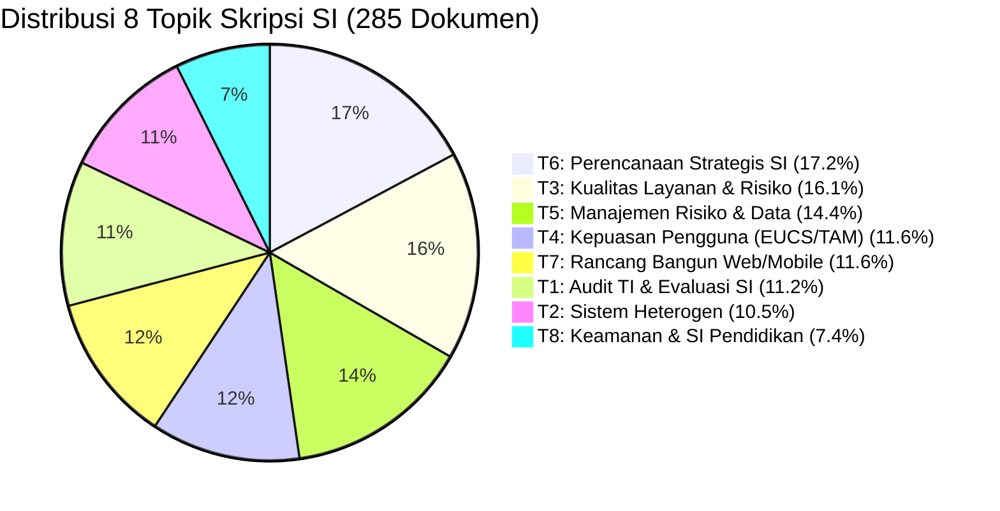

# 🎯 GROUND TRUTH — Rujukan Resmi Angka & Spesifikasi Skripsi

> [!IMPORTANT]
> **Satu-satunya Rujukan Resmi:** Semua angka di Bab III, IV, V wajib merujuk pada dokumen ini. Jika terdapat ketidaksesuaian dengan berkas eksplorasi/legacy lain, dokumen ini yang sah.

---

## 📊 1. Spesifikasi Korpus & Model Final

| Parameter Korpus / Model | Nilai Resmi | Keterangan / Berkas Rujukan |
| :--- | :---: | :--- |
| **Jumlah Dokumen** | **285 Dokumen** | 2021: 29 \| 2022: 78 \| 2023: 46 \| 2024: 47 \| 2025: 85 |
| **Ukuran Kosakata** | **1.849 Kata** | `data/intermediate/dictionary.gensim` |
| **Model LDA Binary** | `model/lda_model.gensim` | Latent Dirichlet Allocation |
| **Jumlah Topik ($K$)** | **8 Topik** | Dipilih berdasarkan optimasi koherensi & interpretabilitas |
| **Alpha / Eta** | `asymmetric` / `auto` | Vektor prior yang diestimasi Gensim dari data latih |
| **Passes / Iterations** | **30 / 500** | Full convergence training |
| **Random State / Seed** | **42** | Terkunci untuk reproduksibilitas |
| **Metode Inferensi** | Online Variational Bayes | Gensim 4.4.0 Engine (**bukan** Gibbs Sampling) |
| **Rata-rata Token/Dokumen** | **58,1 token** | 33,2 term rata-rata setelah `filter_extremes` |

---

## 🧪 2. Metrik Evaluasi Resmi Model ($K=8$)

> [!NOTE]
> **Protokol Evaluasi $C_V$ Resmi:** `texts=data/intermediate/` (v1, 1.849 vocab), `topn=20`, `processes=1` (Gensim CoherenceModel 4.4.0).
> Seluruh angka di bawah **dapat direproduksi ulang** dari `model/lda_model.gensim`. Verifikasi: `python run_tests.py`.

| Metrik Evaluasi | Nilai Resmi | Target / Keterangan |
| :--- | :---: | :--- |
| **Coherence Score ($C_V$)** | **`0,4256`** | **Angka Resmi Skripsi** |
| **Coherence Score ($U_{mass}$)** | `-10,7533` | Lebih mendekati 0 lebih baik |
| **Log Perplexity** | `-7,4518` | Log perplexity atas 285 dokumen |
| **Topic Diversity (Top-10)** | `0,7125` | Proporsi keunikan kata antar topik |
| **Topic Diversity (Top-15)** | `0,6917` | Proporsi keunikan kata antar topik |
| **Persentase Ambigu ($\theta < 0.50$)** | `13,33%` | Dokumen keyakinan penugasan rendah |
| **Chi-Square Homogenitas** | $\chi^2 = 23,9132$ | $df = 28$, $p = 0,6861$, Cramér's $V = 0,1448$ |
| **Uji Permutasi Monte Carlo** | $p = 0,7031$ | 10.000 iterasi, seed=42 (rujukan utama) |

---

## 🏷️ 3. Distribusi & Label Topik Resmi

| ID | Label Topik Resmi | Dokumen | Porsi | Kepercayaan |
| :-: | :--- | :-: | :-: | :---: |
| **1** | Audit TI & Evaluasi Kesuksesan SI | 32 | 11,23% | Sedang |
| **2** | Pengembangan & Analisis Sistem Heterogen | 30 | 10,53% | Rendah *(Heterogen)* |
| **3** | Analisis Kualitas Layanan & Risiko SI | 46 | 16,14% | Sedang |
| **4** | Kepuasan Pengguna Akhir (EUCS & TAM) | 33 | 11,58% | Tinggi |
| **5** | Manajemen Risiko TI & Analitik Data | 41 | 14,39% | Sedang |
| **6** | Pengembangan & Perencanaan Strategis SI | 49 | 17,19% | Sedang |
| **7** | Rancang Bangun SI Berbasis Web & Mobile | 33 | 11,58% | Sedang |
| **8** | Keamanan Informasi & SI Institusi Pendidikan | 21 | 7,37% | Rendah *(Heterogen)* |

---

> [!TIP]
> **Rujukan Penting Sidang Skripsi:**  
> Seluruh grafik pada **Dashboard Streamlit (`app/main.py`)** dan tabel pembahasan Bab IV dirancang konsisten menggunakan data dari berkas rujukan ini.
