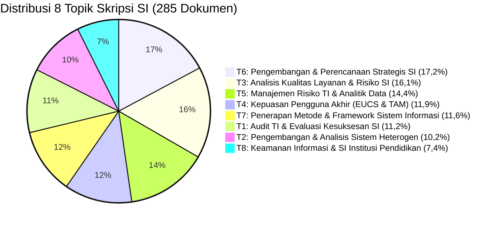

# GROUND TRUTH - Rujukan Resmi Angka & Spesifikasi Skripsi

> **DIBUANG OTOMATIS oleh `src/ground_truth.py`.** Jangan diedit manual.
> Regenerasi: `python -m src.ground_truth`
>
> Sumber angka: artefak di `outputs/model/`, `outputs/topics/`, `outputs/forecast/`, dan `outputs/audit/`.
> Jika angka di skripsi berbeda dengan dokumen ini, dokumen ini yang benar
> karena diturunkan langsung dari artefak pipeline.

_Terakhir dibuat: 2026-10-14 08:39_

---

## 1. Spesifikasi Korpus & Model Final

| Parameter Korpus / Model | Nilai Resmi | Keterangan / Berkas Rujukan |
| :--- | :---: | :--- |
| **Jumlah Dokumen** | **285 Dokumen** | 2021: 29 \| 2022: 78 \| 2023: 46 \| 2024: 47 \| 2025: 85 |
| **Ukuran Kosakata** | **1849 Kata** | `data/intermediate/dictionary.gensim` |
| **Model LDA Binary** | `model/lda_model.gensim` | Latent Dirichlet Allocation |
| **Jumlah Topik (K)** | **8 Topik** | Dipilih berdasarkan optimasi koherensi & interpretabilitas |
| **Alpha / Eta** | `auto` / `auto` | Vektor prior yang diestimasi Gensim dari data latih |
| **Passes / Iterations** | **30 / 500** | Full convergence training |
| **Random State / Seed** | **42** | Terkunci untuk reproduksibilitas |
| **Metode Inferensi** | Online Variational Bayes | Gensim 4.4.0 Engine (**bukan** Gibbs Sampling) |

---

## 2. Metrik Evaluasi Resmi Model (K=8)

> Protokol resmi `C_V`: `texts=data/intermediate/`, `topn=20`, `processes=1`, Gensim 4.4.0.
> Seluruh angka dapat direproduksi ulang dari `model/lda_model.gensim`.
> Verifikasi: `python run_tests.py`

| Metrik Evaluasi | Nilai Resmi |
| :--- | :---: |
| **Coherence Score ($C_V$)** | `0,43` |
| **Coherence Score ($U_{mass}$)** | `-10,75` |
| **Log Perplexity** | `-7,45` |
| Topic Diversity (Top-10) | `0,71` |
| Topic Diversity (Top-15) | `0,69` |
| Persentase Ambigu ($\theta < 0.50$) | `13,33%` |
| Vocabulary Size | `1849,00` |
| Total Dokumen | `285,00` |
| **Model Parameters** | `K=8, alpha=auto, eta=auto, passes=30, iterations=500, seed=42` |

### Uji Homogenitas Komposisi Topik x Tahun

| Statistik | Nilai |
| :--- | :---: |
| $\chi^2$ (chi-square) | `23,9361` |
| Derajat Kebebasan (df) | `28` |
| p-value (asimtotik) | `0,6849` |
| Cramer's V | `0,1449` |
| p-value Permutasi (10.000 iterasi, seed=42) | `0,6994` |

---

## 3. Distribusi & Label Topik Resmi

| ID | Label Topik Resmi | Dokumen | Porsi | Kepercayaan |
| :-: | :--- | :-: | :-: | :---: |
| **1** | Audit TI & Evaluasi Kesuksesan SI | 32 | 11,23% | Sedang |
| **2** | Pengembangan & Analisis Sistem Heterogen | 29 | 10,18% | Rendah |
| **3** | Analisis Kualitas Layanan & Risiko SI | 46 | 16,14% | Sedang |
| **4** | Kepuasan Pengguna Akhir (EUCS & TAM) | 34 | 11,93% | Tinggi |
| **5** | Manajemen Risiko TI & Analitik Data | 41 | 14,39% | Sedang |
| **6** | Pengembangan & Perencanaan Strategis SI | 49 | 17,19% | Sedang |
| **7** | Penerapan Metode & Framework Sistem Informasi | 33 | 11,58% | Rendah |
| **8** | Keamanan Informasi & SI Institusi Pendidikan | 21 | 7,37% | Rendah |

> Total: **285 dokumen** (harus sama dengan jumlah dokumen korpus).

---

## 4. Uji Tren per Topik (Spearman + Bonferroni)

| Topik | Label | rho | p (raw) | p (Bonferroni) | Signifikan? |
| :-: | :--- | :-: | :-: | :-: | :---: |
| 1 | Audit TI & Evaluasi Kesuksesan SI | -0.5 | 0,3910 | 1,0000 | Tidak |
| 2 | Pengembangan & Analisis Sistem Heterogen | -0.2 | 0,7471 | 1,0000 | Tidak |
| 3 | Analisis Kualitas Layanan & Risiko SI | 0.3 | 0,6238 | 1,0000 | Tidak |
| 4 | Kepuasan Pengguna Akhir (EUCS & TAM) | 0.5 | 0,3910 | 1,0000 | Tidak |
| 5 | Manajemen Risiko TI & Analitik Data | -0.6 | 0,2848 | 1,0000 | Tidak |
| 6 | Pengembangan & Perencanaan Strategis SI | 0.6 | 0,2848 | 1,0000 | Tidak |
| 7 | Penerapan Metode & Framework Sistem Informasi | -0.4 | 0,5046 | 1,0000 | Tidak |
| 8 | Keamanan Informasi & SI Institusi Pendidikan | 0.6 | 0,2848 | 1,0000 | Tidak |

> **Tidak ada topik** yang memiliki tren signifikan setelah koreksi Bonferroni.
> Klaim "topik X meningkat signifikan" **dilarang** ditulis di skripsi.

---

> **Rujukan untuk Sidang:**
> Seluruh grafik pada Dashboard Streamlit (`app/main.py`) dan tabel di
> Bab IV dirancang konsisten dengan angka pada dokumen ini.
